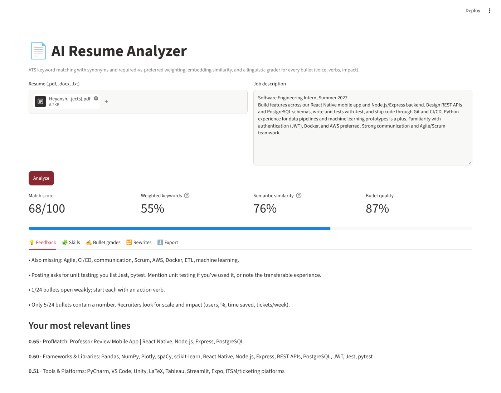
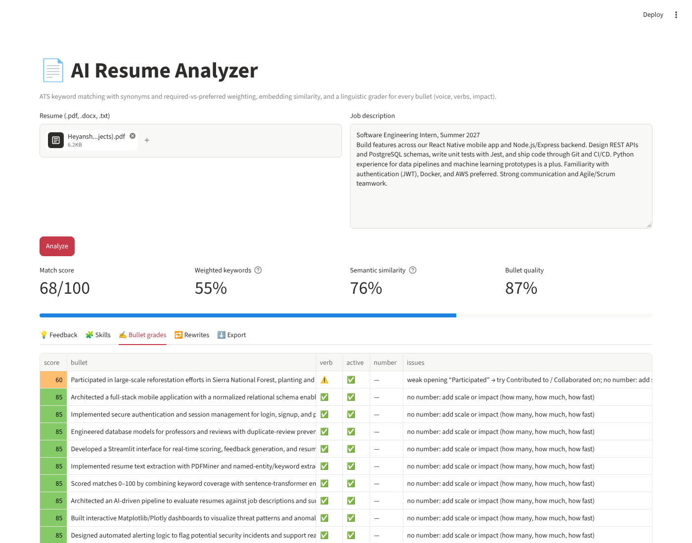

# AI Resume Analyzer

[](https://github.com/HeyanshShah/resume-analyser/actions/workflows/tests.yml)

An NLP tool that scores a resume against a job posting the way both an **ATS** and a
**recruiter** would. It goes beyond keyword counting with computational-linguistics
techniques: synonym-aware skill matching, required-vs-preferred weighting read from the
posting's wording, sentence embeddings, and a **dependency-parse grader for every bullet**
that detects passive voice, weak openings, and missing impact, then rewrites them.



## What it does
| Layer | How | Example |
|---|---|---|
| **Extraction** | PDFMiner / python-docx, section detection, re-joins bullets that PDFs wrap across lines | finds 24 bullets under Experience/Projects |
| **Skill matching** | 143-skill ontology with aliases + spaCy `PhraseMatcher` on lowercase, exact, and **lemma** forms | "JS" → JavaScript, "k8s" → Kubernetes, "troubleshot" → troubleshooting; the verb "go" ≠ Go language |
| **Importance** | posting section headers + cue phrases, judged per sentence | "must know SQL" → required (1.0) · "Docker is a plus" → preferred (0.5) |
| **Partial credit** | substitute skill families | posting wants MySQL, you have PostgreSQL → ½ credit + a tip |
| **Meaning** | `all-MiniLM-L6-v2` sentence embeddings + cosine similarity (TF-IDF fallback) | rewards describing the same *kind* of work |
| **Bullet linguistics** | spaCy POS tags + dependency parse | passive (`nsubjpass`/`auxpass`), weak opening, pronouns, filler, no metric, length |
| **Rewrites** | parse-based transforms; optional Claude API rewrite | "The tickets were resolved by me" → "Resolved the tickets"; "Responsible for managing X" → "Managed X" |

**Score** = 50% weighted keyword coverage + 25% semantic similarity + 25% bullet quality.



## Measured accuracy
Linguistic detectors were evaluated on hand-labeled resume bullets. The **test set was written after
the rules were finished and never used for tuning** (the dev set was used during development).

| Detector | Held-out accuracy | Precision | Recall |
|---|---|---|---|
| Passive voice | 97% | 100% | 83% |
| Weak opening | 93% | 100% | 86% |
| Quantified impact | 97% | 100% | 92% |

Reproduce: `python eval/evaluate_bullets.py test`. Known misses are printed, for example the subject-less
passive "Passwords were reset for faculty", and "Took part in" as a weak phrase.

## Tech stack
Python · spaCy (PhraseMatcher, POS tagging, dependency parsing, lemmatization) · sentence-transformers ·
scikit-learn · PDFMiner · python-docx · Streamlit · Anthropic API (optional) · pytest · GitHub Actions

## Run it
```bash
pip install -r requirements.txt
python -m spacy download en_core_web_sm
streamlit run app.py                                   # web app
python -m analyzer resume.pdf job.txt --json out.json  # command line
```
Optional AI rewrites: `pip install anthropic`, then set `ANTHROPIC_API_KEY`. The prompt forbids
inventing facts and inserts `[X%]` placeholders instead.

## Tests
`pytest` runs 22 tests: synonyms, lemma matching, case-sensitive short names, required/preferred
detection, partial credit, every bullet check, passive→active rewriting, past-tense inflection,
bullet extraction, and an **accuracy floor on the held-out set**. GitHub Actions runs them on every push.

## Layout
```
analyzer/extract.py       file -> text -> sections -> bullets
analyzer/ontology.json    143 skills, aliases, families
analyzer/keywords.py      synonym + lemma matching, weighted coverage, partial credit
analyzer/requirements.py  required vs preferred from headers and cue phrases
analyzer/similarity.py    embeddings / TF-IDF, most relevant lines
analyzer/bullets.py       linguistic grader + rule-based rewriter
analyzer/rewrite.py       optional Claude rewriter
analyzer/scoring.py       overall score + prioritized feedback
eval/                     labeled dev/test sets + evaluation script
```
